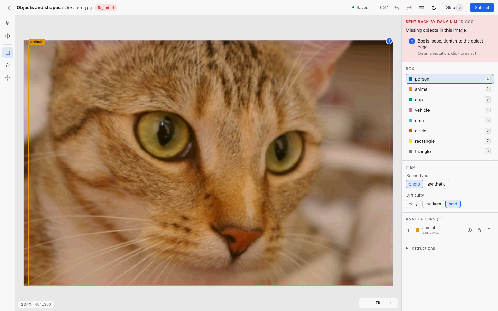

# How annolab works

Teaching notes. They follow a few requests from the browser to the database and back, then open up the editor. Read them with the code open; every section names the files involved.

## 0. The map

```
web/src/api/client.ts      the only module that calls the server
web/src/pages/             one component per screen
web/src/editors/           the four modality canvases, shared panels, annotation store
web/src/lib/               pure logic with unit tests (geometry, history, dsp, tracks, spans, matching)
backend/annolab/routers/   HTTP layer: parse, check role, call a service, serialise
backend/annolab/services.py   queue, autosave, submit, skip, review, item status
backend/annolab/consensus.py  matching and agreement
backend/annolab/models.py     SQLAlchemy tables
```

In development Vite serves the app on 127.0.0.1:5173 and proxies `/api` to the API on 127.0.0.1:8000 (`web/vite.config.ts`), so the browser only ever talks to one origin.

## 1. Logging in

1. `Login.tsx` calls `api.login(email, password)`, which POSTs to `/api/auth/login`.
2. `routers/auth.py` loads the user by email, checks the scrypt hash (`security.py`) and returns `{token, user}`. The token is a signed JWT (PyJWT) carrying the user id.
3. `client.ts` stores the token in `localStorage` and adds `Authorization: Bearer <token>` to every later request. A 401 from any request clears it and sends the app back to the login screen.
4. On the server, every protected route depends on `deps.current_user`, which decodes the token and loads the user. Role checks are dependencies too (`require("admin")` in `deps.py`), so a route's permissions are visible in its signature. `tests/test_permissions.py` checks a 22-row matrix of endpoint by role.

Media is the one exception to the header rule. ``, `<audio>` and `<video>` cannot send headers, so `api.mediaSrc(id)` builds `/api/items/{id}/media?token=...` and the media and thumbnail routes accept the token from the query string.

## 2. Getting the next item

The annotator clicks **Start labeling** (or presses `L` on the projects list).

1. The route `/projects/:id/label` renders `QueueEntry` in `Labeler.tsx`, which calls `GET /api/projects/{id}/queue/next`.
2. `routers/workflow.py` opens a session. Because `db.py` hooks SQLAlchemy's `begin` event to run `BEGIN IMMEDIATE`, this transaction holds SQLite's write lock from its first statement. Any other request that wants to write waits (busy timeout 30 s).
3. `services.next_task` runs:
   - return the caller's open task in this project if there is one, rejected items first;
   - drop assignments that were never saved and are older than 2 hours;
   - otherwise find an item that is unlabeled or in progress, that the caller never had a task for, and that has fewer than `annotators_per_item` live tasks. Prefer items others already started, then the oldest;
   - insert the task, recompute the item status, write an audit event.
4. The transaction commits and releases the lock. The response is the task with its item, the project, any reviews and the caller's annotations. 204 means the queue is empty.
5. `QueueEntry` redirects to `/projects/:id/label/:taskId`.

Why the lock matters: without it, two requests can both read "item 7 has 1 of 2 slots used" and both insert a task, giving item 7 three annotators. With `BEGIN IMMEDIATE` the second request cannot read until the first has committed, so it sees 2 of 2 and moves on. `tests/test_queue.py` fires 12 and 9 threads at the queue at once; replacing `BEGIN IMMEDIATE` with a plain `BEGIN` makes 2 of its 3 concurrency tests fail. The unique `(item_id, user_id)` index is a second guard: even if the logic were wrong, one person cannot hold two tasks for the same item.

## 3. Drawing a box and autosaving it

This is the path most of an annotator's time goes through.

### 3.1 One shell, four canvases

`Labeler.tsx` owns everything that is the same for every modality: top bar (save status, timer, undo, redo, skip, submit), tool rail, class picker, attribute panel, item classifications, annotation list, hotkeys. It renders one `Workspace` (`editors/Panels.tsx`), which picks the canvas:

```tsx
if (p.modality === "image") return <ImageEditor {...p} />;
if (p.modality === "audio") return <AudioEditor {...p} />;
if (p.modality === "video") return <VideoEditor {...p} />;
return <TextEditor {...p} />;
```

All four take the same `EditorProps` (`editors/types.ts`): the item, the schema, the annotation list, the selected annotation, the current mode or tool, the active class, hidden and locked sets, and an `edit` API. A canvas never owns annotations. It draws what it is given and reports changes through `edit`.

Tool rail entries, class lists and attribute fields come from the project schema. The canvas only needs to know how to draw and edit each geometry type it supports: the image canvas handles `bbox`, `polygon` and `point`; audio handles `segment`; video handles `track` and `segment`; text handles `span`.

### 3.2 The annotation store and undo

`useAnnStore` (`editors/store.ts`) wraps a pure undo stack (`lib/history.ts`):

```ts
interface History<T> { past: T[]; present: T; future: T[]; anchor: T | null }
```

- `edit.add`, `edit.patch`, `edit.remove` push a new `present` and move the old one onto `past`.
- A drag is many pointer events but should be one undo step. On pointer down the canvas calls `edit.begin()`, which stores the current list as `anchor`. Each pointer move calls `edit.patch`, which replaces `present` without recording a step. On pointer up `edit.commit()` pushes `anchor` onto `past` once. `edit.cancel()` restores `anchor`.
- Undo and redo move between `past`, `present` and `future`. The stack keeps 200 steps.

All of this is plain functions over immutable data, so `history.test.ts` tests it without React.

Each annotation in the store has a client id `cid`. Annotations loaded from the server get `cid = "s" + id`; new ones get a random id. React keys, selection, hide and lock all use `cid`, so they work before the server has assigned an id.

### 3.3 Pointer to geometry (image)

`ImageEditor.tsx` keeps a view transform `{k, tx, ty}` (scale and offset). A screen point becomes an image point with `((sx - tx) / k, (sy - ty) / k)`. Boxes are stored in source pixels, so zooming never changes stored geometry. Hit testing (`lib/geometry.ts`) checks resize handles, then vertices, then edges, then bodies, with a tolerance in screen pixels divided by `k` so handles are equally easy to grab at any zoom.

With the box tool and a class selected, pointer down starts a `create` drag, pointer move updates a preview rectangle, and pointer up adds the annotation if it is at least 4 screen pixels in each direction (so a stray click does not create a box).

### 3.4 Autosave

`useAutosave` (`hooks/useAutosave.ts`) watches the annotation list.

1. Every change bumps a version counter and sets the status to Unsaved.
2. 700 ms after the last change it calls `PUT /api/tasks/{id}/annotations` with the full list and the time spent.
3. The status chip in the top bar is an `aria-live` region: Saved, Unsaved, Saving, Offline or Save failed.
4. A network failure sets Offline and retries every 4 s and on the browser's `online` event.
5. Submit, skip and leaving the page call `flush()`, which waits for any save in flight and then saves whatever is newer.

On the server, `services.replace_annotations` treats the request as the task's complete set:

- validate every entry against the schema first, so a bad request writes nothing;
- entries with an `id` that belongs to this task update that row; entries without one become new rows; rows not mentioned are deleted;
- `time_spent_ms` only grows.

Sending the whole set makes the client simple (no diffing, no ordering problems between saves) and the request is idempotent: saving the same list twice gives the same result. Keeping ids is what lets review comments stay attached to an annotation after the annotator edits it. The e2e review-cycle test checks this: the annotator moves the box the reviewer commented on, and the test asserts the annotation id did not change.

## 4. Submitting and review

1. **Submit** flushes autosave, then `POST /api/tasks/{id}/submit`. `services.submit_task` marks the task submitted and calls `refresh_item_status`.
2. `refresh_item_status` derives the item status from its tasks and its latest review. With enough submitted tasks and no open ones, the item becomes `in_review` (or `labeled` if the project does not require review). No other code sets item status.
3. The reviewer opens **Review**. `GET /api/projects/{id}/review/queue/next` returns the oldest item in review, with every annotator's set, all earlier reviews and the item's agreement.
4. `Review.tsx` renders the same canvas as the labeler, read-only, with each annotator's set as a coloured overlay that `1`-`9` toggles. The consensus diff comes from `GET /api/items/{id}/consensus`: matched pairs with their overlap, label conflicts, and annotations only one person drew.
5. `C` enters comment mode. Clicking a shape pins the comment to that annotation; clicking empty space pins it to a point (image, video) or a time (audio).
6. **Reject** posts `{decision: "reject", comment, comments: [{annotation_id, x, y, t, body}]}` to `/api/items/{id}/reviews`. `services.create_review` reopens only the tasks of annotators whose annotations were pinned (or everyone if nothing was pinned) and recomputes the status, which becomes `rejected`.
7. The next time that annotator asks the queue for work, step 1 of `next_task` returns the reopened task first. The labeler shows a "Sent back by" banner and numbered pins on the canvas; clicking a pin attached to an annotation selects it.



## 5. Agreement

`consensus.item_consensus` takes, for one item, a map from annotator to annotations.

For each tool and each pair of annotators:

1. Compute the similarity of every pair of annotations: IoU for boxes and polygons, interval IoU for segments and spans, mean box IoU over time for tracks, a Gaussian of distance for points.
2. Sort candidate pairs by similarity, highest first, and take a pair if neither side is used yet and the similarity is at least the threshold (0.5). This greedy matching is not the optimal assignment, but with thresholds at 0.5 two annotations can rarely both match the same third one well, and it is easy to explain to a reviewer.
3. Agreement = `2 * same-label matches / (|A| + |B|)`, the F1 score of one set against the other.

A worked example. Annotator A draws three boxes, B draws two. Two pairs overlap with IoU at least 0.5, and one of those has the same label. Agreement = 2 x 1 / (3 + 2) = 0.4. `test_consensus.py` has this case.

Classifications give 1 or 0 per pair per item. Over a project, the stats endpoint also computes Cohen's kappa per annotator pair and Fleiss' kappa over everyone (`cohen_kappa`, `fleiss_kappa`). Kappa corrects for chance: if everyone answers "good" 90 % of the time, raw agreement is high even for random raters, and kappa says so.

The web client has its own copy of the matching (`lib/match.ts`) for the review overlay. The backend result is the reference; the review diff uses the server's matches.

## 6. Audio: waveform, spectrogram and proposals

`AudioEditor.tsx`:

1. Fetches the WAV through the media URL and decodes it with `AudioContext.decodeAudioData`.
2. **Waveform.** `lib/dsp.peaks` reduces the visible window to one min/max pair per pixel column, so drawing cost depends on the canvas width, not the file length.
3. **Spectrogram.** `lib/dsp.spectrogram` runs a radix-2 FFT (`lib/dsp.fft`) over 512-sample Hann windows. Magnitudes go to dB and are scaled between percentiles so quiet recordings are still readable, then drawn as an image on a canvas.
4. **Playback.** An `<audio>` element plays the same URL; the server supports HTTP Range so seeking works. A `requestAnimationFrame` loop moves the playhead.
5. **Proposals.** *Propose* calls `POST /api/items/{id}/prelabel`. The server band-passes the signal, takes the Shannon energy envelope, thresholds it and labels S1 or S2 from the gap pattern (`prelabel.heart_segments`). Proposals are drawn dashed and are not stored until accepted (`A` or `Shift+A`). If the request fails, the editor runs a local energy detector (`lib/dsp.detectOnsets`) instead. While drawing or dragging, segment edges snap to the nearest proposal or segment edge within a few screen pixels (`SNAP_PX`).

## 7. Video tracks

A track is `{keyframes: [{t, x, y, w, h}, ...]}`. `lib/track.interpolate` finds the two keyframes around time `t` and interpolates each coordinate linearly; outside the first and last keyframe the track does not exist. Pressing `K` (or dragging the box at a time that is not a keyframe) inserts a keyframe at the current frame; `Shift+K` removes it. The timeline under the video draws each track's extent and its keyframes as diamonds. Times are snapped to frame boundaries using the item's fps.

## 8. Text spans

A span is `{start, end}` in characters. On mouse up `TextEditor.tsx` reads the DOM selection, converts it to character offsets and widens it to word boundaries (`lib/spans.snapToWords`). Overlapping spans are a lane assignment problem: `lib/spans.assignLanes` gives each span the lowest lane not used by an overlapping span, and each lane is drawn as its own underline offset below the text.

## 9. Exports

`exporters.py` builds three formats from the same rows:

- **COCO** (image projects): one image per item, categories from the schema's classes, boxes as `bbox`, polygons as `segmentation` plus their bounding box. Tested by loading the output with pycocotools.
- **YOLO** (image projects): a zip with one `.txt` per image (`class cx cy w h`, normalised) and `classes.txt`. Polygons become their bounding boxes.
- **JSONL** (every modality): one line per item with its annotations, attributes and review state.

By default each item exports the annotations of the annotator who agrees most with the others (`consensus.best_annotator`); `annotator=all` exports everyone's.

## 10. Exercises

1. Add a `line` tool for images (two points). Which files change? (Hint: `labelschema.py` for validation, `geometry.py` for similarity, `ImageEditor.tsx` for drawing and hit testing, `Panels.tsx` for the rail.)
2. Replace greedy matching with the Hungarian algorithm (`scipy.optimize.linear_sum_assignment`). Do the seeded agreement numbers change?
3. Make the stale-assignment window a project setting instead of a constant.
4. Move the spectrogram computation into a Web Worker and measure the main-thread time before and after on a 5-minute recording.
