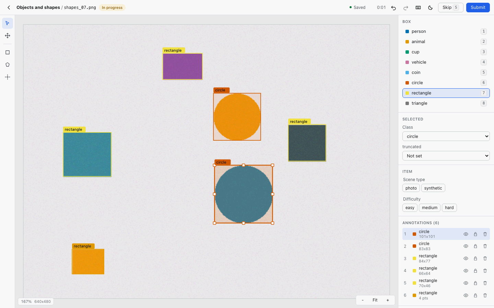
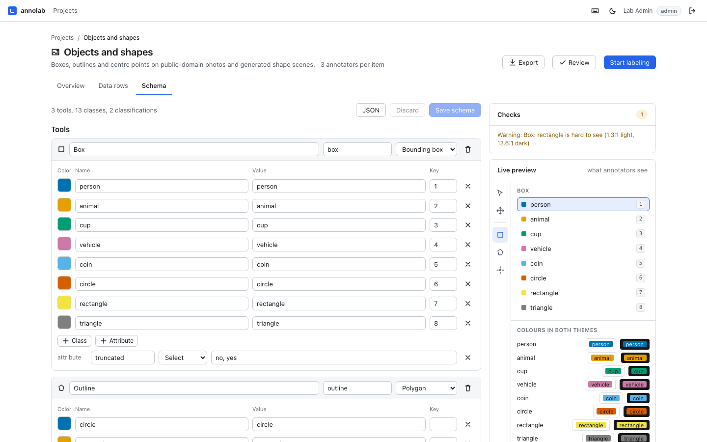
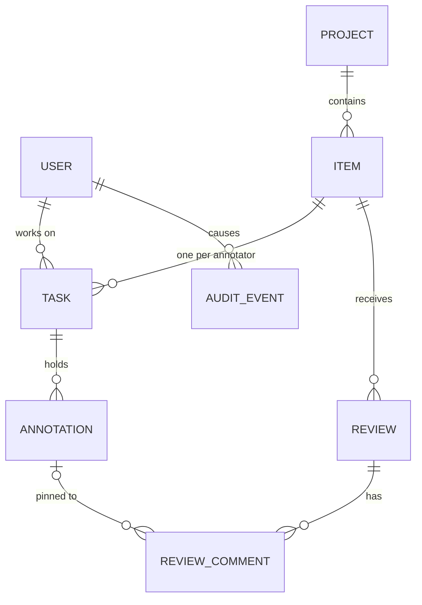
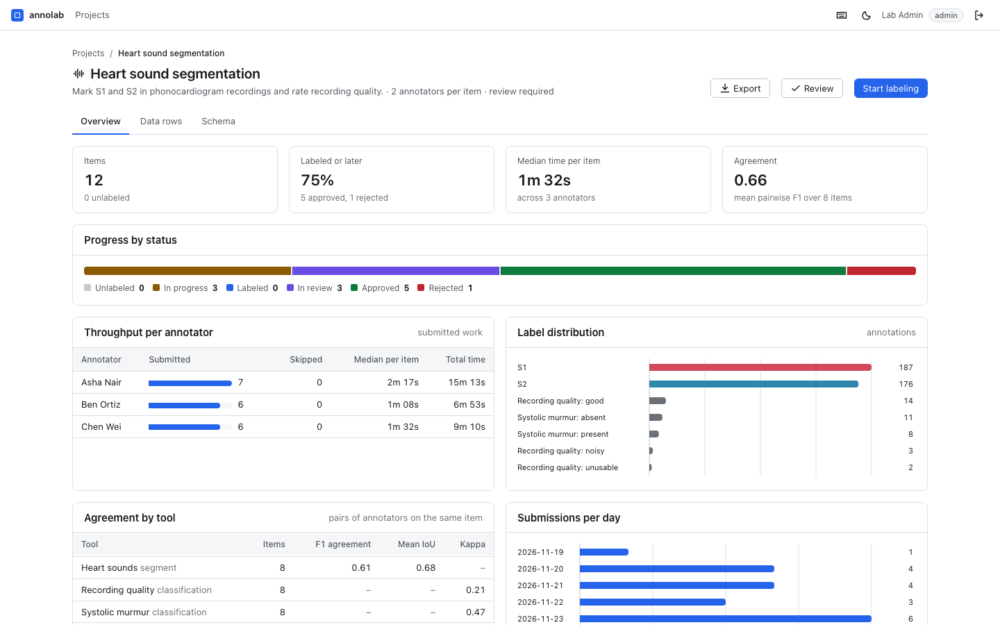
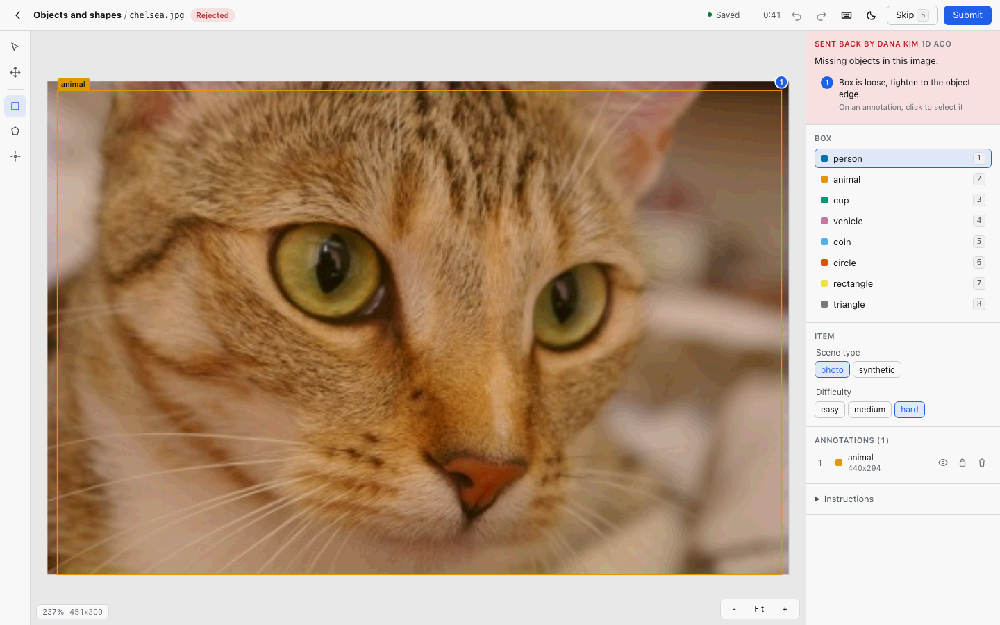
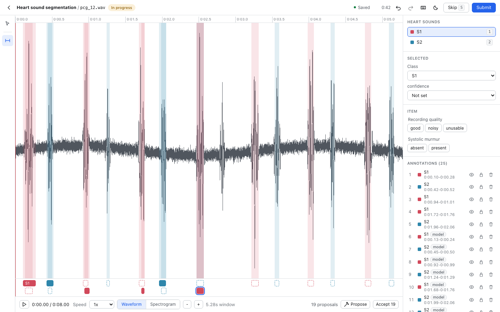
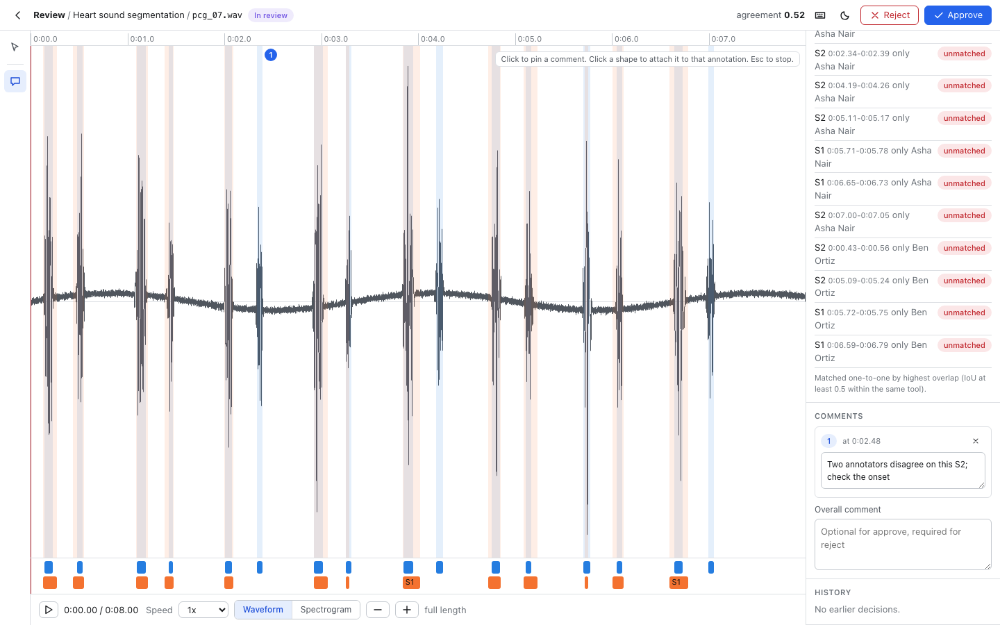
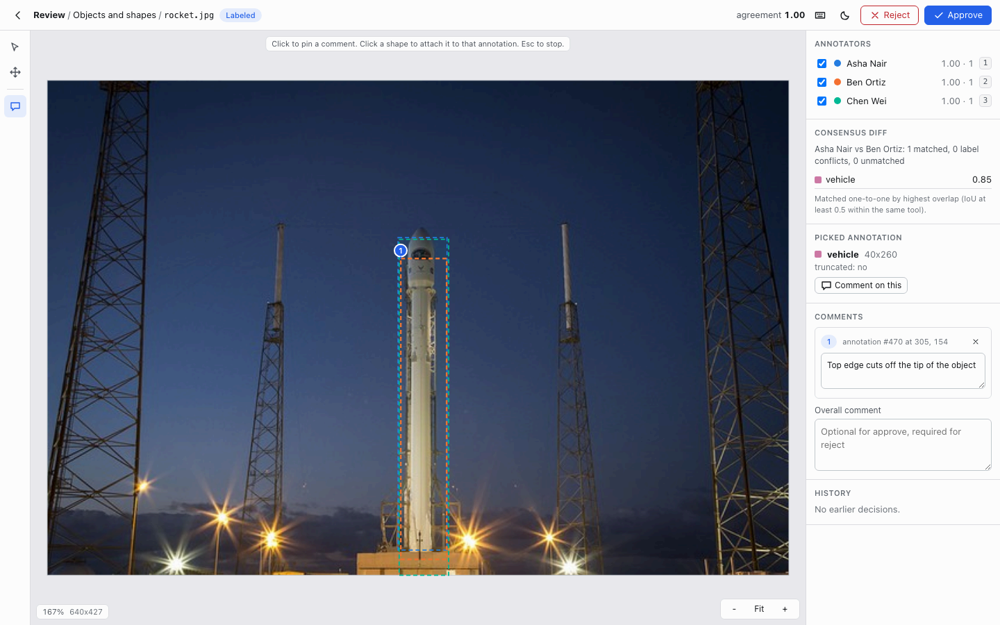
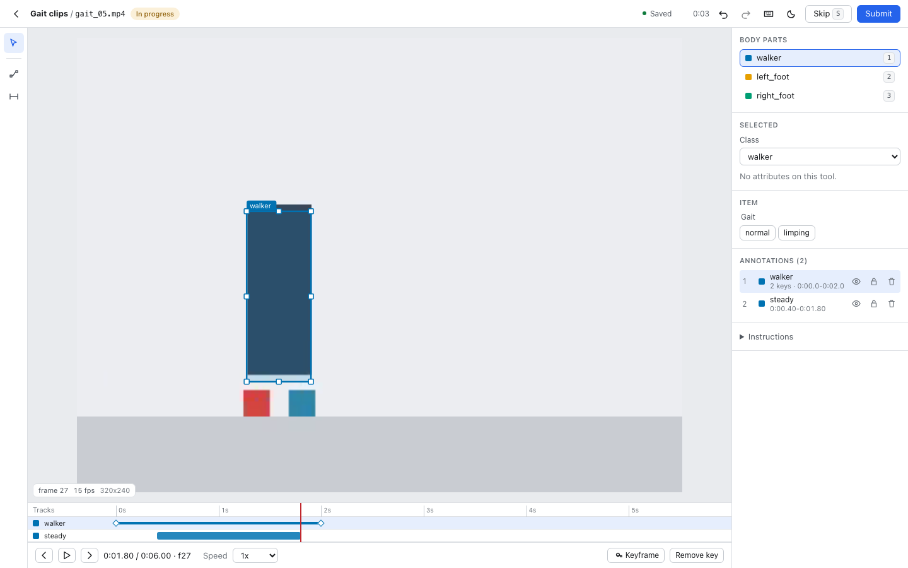
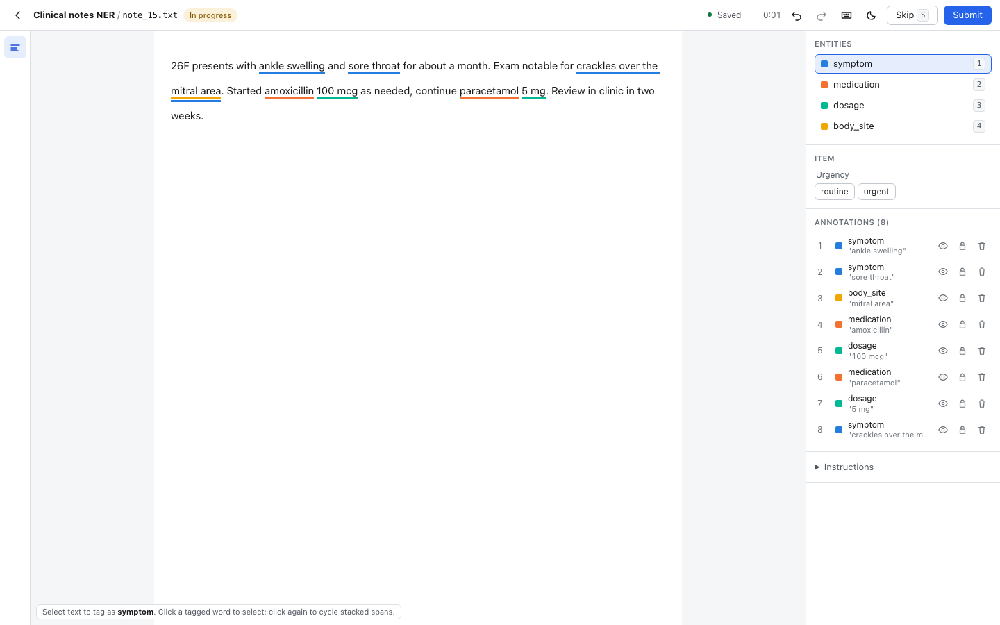

# annolab: report

This report describes annolab, a labeling platform for image, audio, video and text data. It covers the problem, the design decisions, the data model, how agreement is measured, how the labeling queue hands out work, the pre-labelling methods and their accuracy, how the system was evaluated, and what it does not do yet.

Every number here comes from a command run on the development machine (Apple M4 Pro). The command is named next to the number.



## 1. Problem

Supervised models need labeled data, and in clinical work the labels are expensive: a cardiologist marking S1 and S2 in a phonocardiogram, or a clinician boxing lesions in an oral-cavity photo. A labeling tool for this setting has to do four things well.

1. **Cover several modalities with one workflow.** A single study can mix recordings, photos, video and notes. Annotators and reviewers should not learn a new tool per modality.
2. **Make labeling fast.** Most of an annotator's time goes into the editor, so zoom, hotkeys, undo and autosave matter more than any dashboard.
3. **Measure quality.** One annotator per item says nothing about label reliability. The tool should support several annotators per item, measure how much they agree, and let a reviewer send work back with a precise explanation.
4. **Get data in and out in standard formats** (COCO, YOLO, JSONL).

annolab replaces a course team project built for the same domain. That project hard-coded a workspace per modality and a panel per label type, had no agreement metrics, and its backend tests only ran against a live server and database. Section 7.4 compares the two with measured facts.

## 2. Design decisions

### 2.1 One annotation model for every modality

Every label is a row with the same shape:

```
(item, annotator, schema_key, label, geometry, attributes, source)
```

`schema_key` names the tool in the project schema, `label` is the class value, `geometry` depends on the tool type, `attributes` holds per-annotation fields such as `confidence`, and `source` is `human` or `model`.

| Tool type | Geometry | Used by |
|---|---|---|
| `bbox` | `{x, y, w, h}` in source pixels | image |
| `polygon` | `{points: [[x, y], ...]}` | image |
| `point` | `{x, y}` | image |
| `segment` | `{start, end}` in seconds | audio, video |
| `track` | `{keyframes: [{t, x, y, w, h}, ...]}`, linear interpolation between keys | video |
| `span` | `{start, end}` character offsets | text |
| classification | none, only `label` | all |

The schema decides which tools a project has. Adding a label type means editing the schema in the schema editor, not writing a new panel. The backend validates the schema per modality and every annotation against it (`backend/annolab/labelschema.py`), so a box on an audio project or an unknown class is rejected with a 422 before anything is written.



### 2.2 SQLite, in-process tests, no services

The backend is FastAPI with SQLAlchemy 2 on a single SQLite file. A labeling team of a few dozen people produces far fewer writes than SQLite handles. One file means no database server to start, and the tests can create a fresh database per test in a temp folder. All 132 backend tests run in-process with FastAPI's TestClient (`make backend-test`: `132 passed in 17.62s`).

### 2.3 Status is derived, never set by hand

An item's status (`unlabeled`, `in_progress`, `labeled`, `in_review`, `approved`, `rejected`) is recomputed from its tasks and its latest review after every change (`refresh_item_status` in `services.py`). Nothing else writes it, so a status can never disagree with the tasks underneath it.

### 2.4 Front end without a component library

The web app is React 18 and TypeScript with three runtime dependencies (react, react-dom, react-router-dom). All colours, spacing steps and radii are CSS variables in one stylesheet (`web/src/styles.css`), with one accent colour and light and dark themes that follow the system setting. The editors draw with SVG (image, video overlays), canvas (waveform and spectrogram) and the DOM (text). The production bundle is 317.79 kB of JS (101.16 kB gzip) and 19.19 kB of CSS (`npm run build`).

## 3. Data model



| Table | Key fields |
|---|---|
| User | email, name, role (admin, annotator, reviewer), password hash, active |
| Project | name, modality, schema (JSON), annotators_per_item, review_required, instructions |
| Item | project, kind, filename, media path, meta (size, duration, fps, sample rate, text), status |
| Task | item, user, status (assigned, in_progress, submitted, skipped), started/submitted at, time spent; unique on (item, user) |
| Annotation | task, item, user, schema_key, label, geometry, attributes, source |
| Review | item, reviewer, decision (approve, reject), comment |
| ReviewComment | review, optional annotation, body, anchor `x`/`y` or `t` |
| AuditEvent | user, project, action, entity, payload, time |

Two additions to the original spec: `AuditEvent.project_id`, so the activity feed can filter by project with an index, and `User.active`, so admins can deactivate accounts without deleting their work. Tasks, items and annotations use SQLite `AUTOINCREMENT` so a deleted id is never handed out again; review comments refer to annotation ids, and a reused id would point a comment at the wrong shape.

## 4. Agreement

Agreement is computed per item from the submitted annotation sets of its annotators (`backend/annolab/consensus.py`, `geometry.py`).

### 4.1 Geometric tools

For each tool and each pair of annotators A and B:

1. Compute the similarity of every annotation in A with every annotation in B:
   - boxes and polygons: intersection over union (IoU) of the areas;
   - segments and spans: IoU of the intervals, `overlap / union` of `[start, end]`;
   - tracks: the mean box IoU at 0.1 s steps over the union of the two tracks' time spans, so a track that starts late or stops early is penalised;
   - points: `exp(-d^2 / (2 * 10^2))` for a distance `d` in pixels.
2. Match greedily, highest similarity first, one-to-one, keeping only pairs at or above a threshold (0.5 by default, `?threshold=` on the consensus endpoint).
3. Score the pair as

   ```
   agreement(A, B) = 2 * (matched pairs with the same label) / (|A| + |B|)
   ```

   which is the F1 score of one set against the other. The mean IoU of the matched pairs is reported next to it.

Item agreement is the mean over tools and pairs; project agreement is the mean over items with at least two annotators.

### 4.2 Classifications

Per item, two annotators agree (1) or not (0) on a radio classification; checklists use the Jaccard index of the chosen options. Across items, the stats endpoint also reports:

- **Cohen's kappa** for each annotator pair over the items both rated: `kappa = (p_o - p_e) / (1 - p_e)`, where `p_o` is the observed share of agreement and `p_e = sum_k p_A(k) * p_B(k)` the agreement expected by chance from each rater's label frequencies.
- **Fleiss' kappa** over all raters: for item `i` with `n_i` ratings and `n_ij` of them in category `j`, `P_i = sum_j n_ij (n_ij - 1) / (n_i (n_i - 1))`; `P_bar` is the mean of `P_i`, `P_e = sum_j p_j^2` with `p_j` the share of all ratings in category `j`, and `kappa = (P_bar - P_e) / (1 - P_e)`. Items may have different numbers of raters; each needs at least two.

The unit tests check these against hand-worked values, including the textbook Cohen example (kappa 0.4) and a 10-item Fleiss example (kappa 0.20993).

### 4.3 Agreement on the seeded data

From `GET /projects/{id}/stats` on a fresh `make seed` (three simulated annotators with different noise levels):

| Project | Items compared | Tool or classification | Agreement (F1) | Mean IoU | Fleiss kappa |
|---|---|---|---|---|---|
| Heart sound segmentation | 8 | segments | 0.613 | 0.682 | |
| | | recording quality | | | 0.213 |
| | | systolic murmur | | | 0.467 |
| Objects and shapes | 13 | boxes | 0.766 | 0.840 | |
| | | outlines (7 items) | 0.397 | 0.911 | |
| | | centre points (7 items) | 0.627 | 0.766 | |
| | | scene type | | | 1.000 |
| | | difficulty | | | 0.058 |
| Gait clips | 4 | tracks | 0.867 | 0.692 | |
| | | phase segments | 1.000 | 0.946 | |
| | | gait | | | -0.333 |
| Clinical notes NER | 14 | entity spans | 0.790 | 0.932 | |
| | | urgency | | | 0.850 |

The outline row shows why both numbers are reported: matched polygons overlap well (IoU 0.911), but annotators often disagreed on whether to draw an outline at all, so F1 is low. The gait kappa rests on 4 items and means nothing beyond showing the computation.

The overview screen shows these per tool, and the review screen shows the matching for one item as a diff.



## 5. Queue logic

`GET /projects/{id}/queue/next` returns the caller's next task, or 204 when there is nothing left.

1. If the caller has an open task in the project (assigned or in progress), return it. Tasks on rejected items come first, so feedback is handled before new work.
2. Release assignments that were never saved and are older than 2 hours, so an annotator who opens an item and walks away does not block it.
3. Otherwise pick an item in the project that is unlabeled or in progress, that the caller has never had a task for (including skipped ones), and whose count of assigned, in-progress and submitted tasks is below `annotators_per_item`. Items that others already started come first, so items get finished instead of all being half done; ties go to the oldest item.
4. Create the task and recompute the item's status, in the same transaction.

The hard part is concurrency: two annotators asking at the same moment must not both take the last free slot of an item. Every SQLite transaction starts with `BEGIN IMMEDIATE`, which takes the write lock before the capacity check runs, so the check and the insert cannot interleave with another request. A unique index on `(item_id, user_id)` is the second guard against one user getting the same item twice.

The tests run the queue from 12 and 9 threads at once and from 8 threads for one user. To check that the lock is what makes them pass, I changed `BEGIN IMMEDIATE` to a plain `BEGIN` and ran them again: 2 of the 3 concurrency tests failed (`test_concurrent_users_never_share_an_item`, `test_concurrent_mixed_capacity`). With the change reverted all three pass.

**Autosave.** `PUT /tasks/{id}/annotations` replaces the task's whole set. Entries that carry an existing `id` keep it; entries left out are deleted. The whole request is validated before anything is written. Keeping ids matters for review: a reviewer's comment pinned to an annotation still points at the same box after the annotator moves it and the editor saves again.

**Review.** Approve or reject an item once all its tasks are submitted. A reject reopens only the tasks of annotators whose annotations carry pinned comments (or the ones listed in `reopen_user_ids`, or everyone if nothing was pinned). Those annotators get the item back first from the queue, with the review attached, and see the comments as numbered pins.



## 6. Pre-labels

Pre-labels are proposals from simple local methods with no network and no learned weights. `POST /items/{id}/prelabel` returns them without storing them; the editor shows them dashed, and the annotator accepts one (`A`) or all (`Shift+A`). Accepted proposals are saved with `source = model`.

### 6.1 Heart sounds

1. Band-pass the signal to 25 to 150 Hz, where S1 and S2 energy sits, which removes most murmur energy and baseline wander.
2. Normalise and compute the Shannon energy `-x^2 log x^2`, smoothed over 20 ms.
3. Threshold the envelope at 0.25 of its 99th percentile, merge regions less than 50 ms apart and drop regions shorter than 40 ms.
4. Label each region: a sound is S1 when the gap after it (systole) is shorter than the gap before it (diastole). This holds for heart rates under about 120 bpm.

### 6.2 Images

Take the median colour of the border pixels as the background, mark pixels further than 40 colour units from it, open the mask with a disk of radius 2, and box each connected component larger than 0.2 % of the image. The box's fill ratio (extent) guesses the shape class: above 0.9 rectangle, above 0.65 circle, else triangle.

### 6.3 Accuracy

The seed data is synthetic with known ground truth, so the proposals can be scored. A proposal matches a true object at IoU 0.5 or more, one-to-one (`make eval-prelabel`):

| Data | True objects / proposals | Precision | Recall | Mean IoU of matches | Other |
|---|---|---|---|---|---|
| Heart sounds, 12 recordings, label must match | 240 / 237 | 0.954 | 0.942 | 0.674 | median onset error 16.5 ms |
| Heart sounds, label ignored | 240 / 237 | 0.966 | 0.954 | | |
| Shape scenes, 10 images | 42 / 42 | 1.000 | 1.000 | 0.962 | |

These numbers are an upper bound. The heart sounds are generated at 25 dB SNR with a regular rhythm, and the shape scenes have flat backgrounds. On the scikit-image photos the image method only gives rough boxes, and on real recordings with arrhythmia the S1/S2 rule will mislabel beats.



## 7. Evaluation

### 7.1 Tests

`make test` runs everything below and exited 0 in 51.5 s wall time.

| Suite | Command | Result |
|---|---|---|
| Backend | `cd backend && uv run pytest` | 132 passed in 17.62 s |
| Web unit | `vitest run` | 8 files, 57 tests passed |
| Typecheck | `tsc --noEmit` | clean |
| End to end | Playwright via `scripts/with-stack.sh` | 6 passed (28.7 s) |

The backend tests cover auth, a 22-row role matrix, schema validation, the queue (including the three concurrency tests), autosave, the review cycle with pinned comments, consensus math against hand-worked values, exports (COCO loaded with pycocotools, YOLO zip contents, JSONL parsed), media with HTTP Range, pre-label precision and recall on synthetic data, stats, activity, and a small seed build.

The web unit tests cover geometry (IoU, hit testing, resize, zoom), track interpolation, the undo stack, span layout, palette contrast, the FFT, spectrogram and onset detection, annotation matching and schema validation.

The Playwright specs run against a throwaway stack: a freshly seeded data dir in a temp folder and the API and Vite on free ports. They never touch `data/`. They cover:

- an admin creating a project, editing its schema and uploading files;
- an annotator drawing a box with a class on an image and a segment on an audio recording and submitting both;
- a reviewer rejecting with a comment pinned to the box;
- the annotator seeing that comment, fixing the box and resubmitting, and the reviewer approving;
- the admin exporting COCO, with the test checking the file's images, annotations and categories;
- a crawl of every screen and editor as each role that fails on any console error or failed API call.

### 7.2 Screens

`make screenshots` takes 18 PNGs at 1440x900 from freshly seeded data (3 Playwright tests passed in 26.5 s); the largest is 386,647 bytes. Each one was opened and checked for overlap, clipping, empty panels and contrast.









### 7.3 Seed and runtime

`make seed` builds 4 projects, 54 items, 101 tasks, 1,029 annotations and 15 reviews in 1.2 s, with no downloads. The videos need ffmpeg.

### 7.4 Compared with the course project

Line counts are `git ls-files` + `wc -l` in each repository, excluding lock files, build configs and media.

| | Course project | annolab |
|---|---|---|
| Backend source | 6,552 lines of Python (FastAPI + MongoDB) | 3,904 lines of Python (FastAPI + SQLite) |
| Frontend source | 21,675 lines of JS/JSX + 2,621 CSS | 7,168 lines of TS/TSX + 1,297 CSS |
| Backend tests | 376 test functions in 14 files (3,909 lines); `conftest.py` sends every request to `http://localhost:8000`, so a running server and database are required | 132 tests (1,423 lines), in-process with a temp database |
| Frontend tests | none | 57 unit tests and 6 Playwright tests, started by `make test` |
| Editor architecture | one workspace component per modality (`SoundAnnotatorWorkspace`, `ImageAnnotatorWorkspace`, `VideoAnnotatorWorkspace`, `TextAnnotatorWorkspace`) plus hand-written panels per label type | one labeler shell and one annotation model; tools, classes and attributes come from the schema |
| Agreement | none | IoU-based matching per tool, Cohen and Fleiss kappa |

The course project has more backend tests by count, but they exercise a live deployment and leave data behind (one file, `test_99_cleanup.py`, exists to clean up). annolab's tests are fewer and each one starts from an empty database.

## 8. Limitations

- **Video** has no zoom or pan, and boxes in the video editor cannot be nudged with the arrow keys.
- **Polygons** can have their vertices dragged, but vertices cannot be added or removed after the polygon is closed.
- **Text spans** are created with the mouse; the keyboard can only adjust them afterwards (Shift+Arrows).
- **Long audio** (minutes) is untested. The waveform and spectrogram are computed on the main thread, and the spectrogram is capped at about 3000 frames.
- **Review diff** compares the first two visible annotators only.
- **Exports**: COCO and YOLO are for image projects only; polygons become boxes in YOLO and points are not exported to COCO. Audio, video and text export as JSONL.
- **Pre-labels** exist only for audio and images, and their accuracy is measured on synthetic data only (section 6.3).
- **Throughput** on the overview is not filtered by date range.
- **Scale**: SQLite serialises all writes. That is fine for a lab, not for hundreds of concurrent annotators.
- **Auth** is a bearer token in local storage; media URLs carry the token as a query parameter because `<audio>`, `<video>` and `` cannot send headers. That is acceptable on a local or lab network, not on the open internet.
